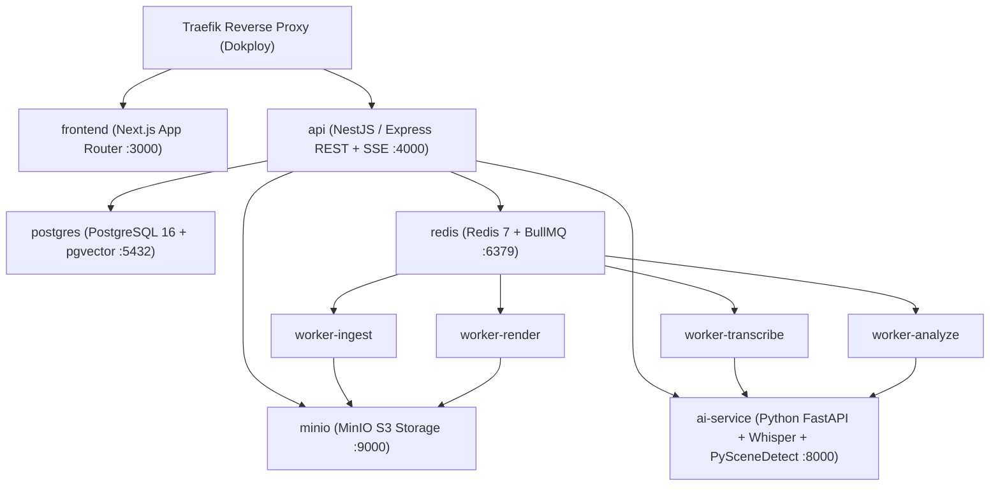

# ARQUITECTURA DEL SISTEMA — BANANA CLIPS AI STUDIO

## 1. Visión General de Servicios (Dokploy)

Toda la plataforma se compone de 9 servicios contenerizados orquestados mediante Docker Compose en Dokploy:

## 2. Separación de Responsabilidades

- **`apps/web` (`frontend`)**: Interfaz profesional en Next.js App Router, Tailwind CSS, Zustand y reproductor HTML5 personalizado con previsualización en tiempo real de subtítulos y timeline no destructivo.
- **`apps/api` (`api`)**: API versionada `/api/v1/`, autenticación Argon2id + JWT rotativos, RBAC (`SUPER_ADMIN`, `USER`), protección SSRF, firma HMAC de URLs privadas y emisión de eventos de progreso mediante Server-Sent Events (SSE).
- **`apps/ai-service` (`ai-service`)**: Microservicio interno en Python con detección automática de hardware (`CPU_ONLY`, `NVIDIA_LOW_VRAM`, `NVIDIA_HIGH_VRAM`), inspección `FFprobe`, detección de silencios y energía vocal, detección de escenas con `FFmpeg scdet`/`PySceneDetect`, generación de embeddings semánticos multilingües de 384 dimensiones y detectores modulares para videojuegos.
- **`workers/` (`worker-ingest`, `worker-transcribe`, `worker-analyze`, `worker-render`)**: Ejecución asíncrona de trabajos con estados granulares (`QUEUED`, `DOWNLOADING`, `PROBING`, `TRANSCODING`, `TRANSCRIBING`, `ANALYZING`, `SCORING`, `GENERATING_CLIPS`, `RENDERING`, `COMPLETED`, `FAILED`, `CANCELED`), heartbeats y cancelación cooperativa.
- **`packages/database`**: Esquema Prisma normalizado de 27 entidades con soporte nativo para `pgvector` y motor híbrido que permite conectarse a PostgreSQL 16 en Docker o ejecutar una instancia PostgreSQL embebida persistente (`PGlite` + extensión `vector`) en entornos locales sin Docker.
